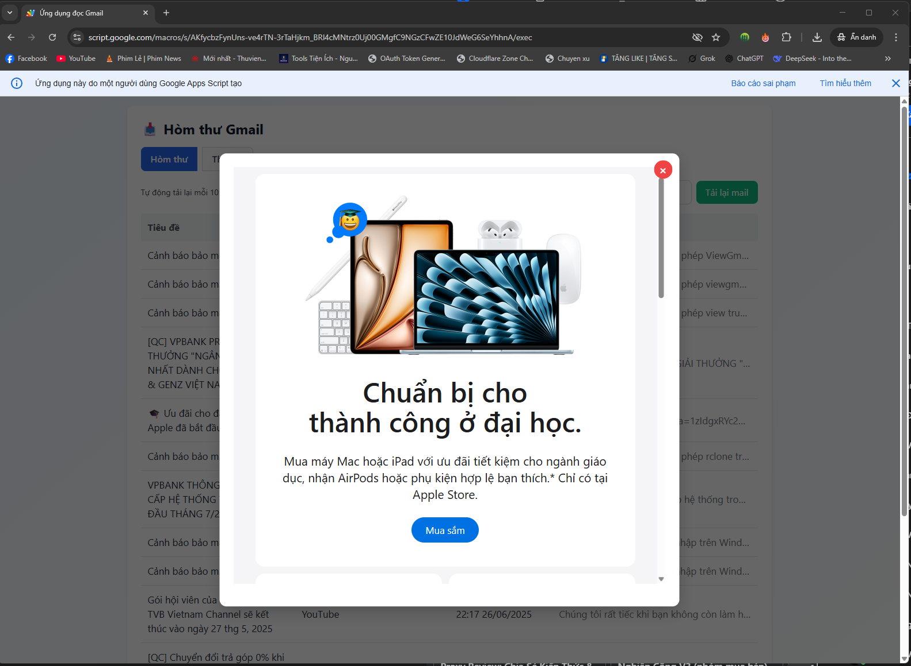

[](README.md)

# Gmail Web Client (Google Apps Script)

A Google Apps Script web interface and JSON POST API for reading Gmail messages (`inbox` and `spam`) with PIN authentication and optional subject/sender filtering.

<p align="center">
  
</p>

## Files

- **`Code.gs`**: Apps Script backend handling Gmail queries, filtering, and POST API endpoints.
- **`index.html`**: Web interface for reading emails after PIN verification.

## API Usage

Send a `POST` request to your deployed Apps Script Web App URL:

```json
{
  "pin": "123456",
  "limit": 10,
  "type": "inbox"
}
```

- `pin`: Access PIN matching `PIN` in `Code.gs` (change the default `"123456"` before deploying)
- `limit`: Maximum number of messages returned (default `100`)
- `type`: `"inbox"` or `"spam"`

Example test with `curl`:

```bash
curl -X POST https://script.google.com/macros/s/.../exec \
  -H "Content-Type: application/json" \
  -d '{"pin":"123456","limit":10,"type":"inbox"}'
```

## Deployment

1. Open [script.google.com](https://script.google.com) and create a new project.
2. Add `Code.gs` and `index.html`.
3. Click **Deploy > New deployment > Web app** (`Execute as: Me`, `Who has access: Anyone`).

## License

Released under the [MIT License](LICENSE).

## Contact

- **Website:** [theloi.io.vn](https://theloi.io.vn)
- **Telegram:** [@theloi194](https://t.me/theloi194)
- **Facebook:** [Lowji194](https://facebook.com/Lowji194)
