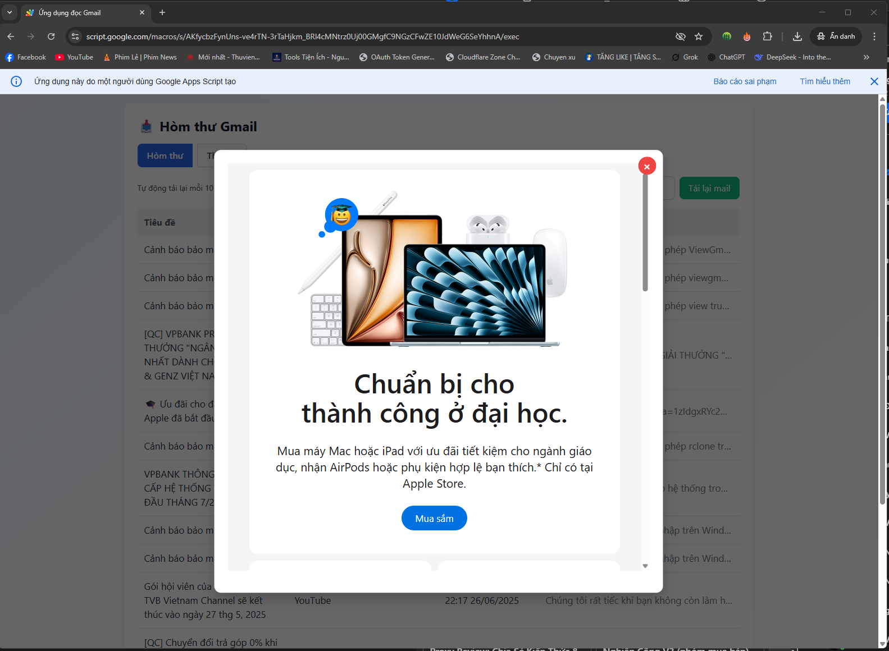

# Ứng Dụng Đọc Gmail

Ứng dụng Google Apps Script để đọc email từ Gmail (hộp thư đến và spam) qua giao diện HTML hoặc API, hỗ trợ lọc email theo tiêu đề/người gửi.
<p align="center">
  
</p>

## Cấu trúc file
- **`Code.gs`**: Chứa logic backend (xử lý API, lấy email, lọc email).
- **`index.html`**: Giao diện HTML để hiển thị email, yêu cầu mã PIN để xác thực.

## Chức năng và biến toàn cục
### Biến toàn cục
- `PIN = "123456"`: Mã PIN để xác thực yêu cầu HTML và API.
- `PIN_EXPIRY_DAYS = 30`: Thời hạn PIN (ngày, hiện chưa sử dụng trong logic).
- `filterEnabled = false`: Kiểm soát việc lọc email. Nếu `true`, loại bỏ email có tiêu đề như "Khuyến mãi", "Bản tin" hoặc người gửi như "no-reply@example.com", "marketing@example.com".

## Hướng dẫn sử dụng API
### Yêu cầu POST
- **URL**: Lấy từ Google Apps Script sau khi deploy (ví dụ: `https://script.google.com/macros/s/.../exec`).
- **Phương thức**: POST
- **Body JSON**:
  ```json
  {
    "pin": "123456",
    "limit": 10,
    "type": "inbox"
  }
  ```
  - `pin`: Mã PIN (phải khớp với `PIN`).
  - `limit`: Số lượng email tối đa (mặc định 100).
  - `type`: `"inbox"` (hộp thư đến) hoặc `"spam"` (thư rác).

### Phản hồi
- **Thành công**:
  ```json
  {
    "success": true,
    "data": [
      {
        "id": "msg-id",
        "from": "Người Gửi <sender@example.com>",
        "subject": "Tiêu đề",
        "date": "27-07-2025, 09:32",
        "snippet": "Nội dung xem trước...",
        "isUnread": false,
        "html": "<p>Nội dung HTML</p>"
      },
      ...
    ]
  }
  ```
- **Lỗi**:
  ```json
  {
    "success": false,
    "error": "Mã PIN không đúng"
  }
  ```

### Kiểm tra API
Sử dụng `curl` hoặc Postman:
```bash
curl -X POST https://script.google.com/macros/s/.../exec \
-H "Content-Type: application/json" \
-d '{"pin":"123456","limit":10,"type":"inbox"}'
```

## Hướng dẫn deploy
1. **Tạo dự án Google Apps Script**:
   - Truy cập [script.google.com](https://script.google.com).
   - Tạo dự án mới, tải lên `Code.gs` và `index.html`.
2. **Triển khai**:
   - Nhấn **Deploy > New deployment > Web app**.
   - Cấu hình:
     - **Execute as**: Me (tài khoản của bạn).
     - **Who has access**: Anyone (hoặc Anyone, even anonymous để truy cập không cần đăng nhập).
   - Nhấn **Deploy**, sao chép URL web app.
3. **Kiểm tra**:
   - Truy cập URL để xem giao diện HTML.
   - Gửi yêu cầu POST đến URL để kiểm tra API.

---

## 📫 Liên hệ với tôi

- 📞 **SĐT:** 0963 159 294
- 🌐 **Website:** [lowji194.github.io](https://lowji194.github.io)
- 📌 **Facebook:** [Lowji194](https://facebook.com/Lowji194)

---

## ☕ Nếu bạn thấy dự án này hữu ích, một ly cà phê từ bạn sẽ là động lực tuyệt vời để mình tiếp tục phát triển thêm!

<p align="center">

</p>
